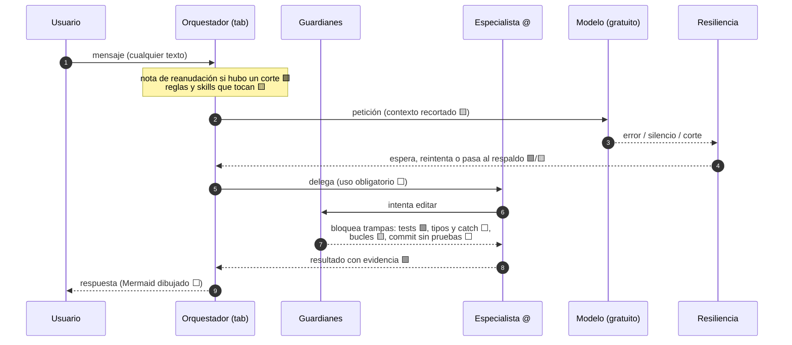

# Mapa de la arquitectura del fork (08-10-2026)

Cómo se organiza el plugin para **controlar al modelo y limar sus inconsistencias**: quién usa a quién y qué capa
vigila qué. Estado sacado de `docs/fork/roadmap.md` a fecha de hoy.

Leyenda: 🟩 **hecho** (en `mis-mejoras`, con pruebas) · 🟨 **en curso / a medias** (código sin fusionar o medición
abierta) · ⬜ **pendiente**.

## 1. Vista general: capas y quién usa a quién

```mermaid
flowchart TB
    U([Usuario])

    subgraph UI["Interfaz (TUI)"]
        SB["Barra lateral<br/>(estado, conexión)"]:::done
        OMOM["/omo-models<br/>(elegir modelos)"]:::wip
        TOAST["Avisos y tarjetas<br/>de reanudación"]:::done
        LAB["Laboratorio visual<br/>y lista de subagentes (7.x)"]:::todo
        MERM["Mermaid dibujado<br/>en el chat (0.19)"]:::todo
        GVIS["Guardianes visibles<br/>(0.18)"]:::todo
    end

    subgraph TAB["Orquestadores (agentes de tab): planifican y delegan"]
        SIS["Sisyphus"]:::done
        HEP["Hephaestus"]:::done
        ATL["Atlas<br/>(ejecuta planes)"]:::done
        PRO["Prometheus<br/>(planifica)"]:::done
        ARCH["Planificador arquitecto<br/>FR/NFR/US/ADR + matriz (4.16)"]:::todo
        ROUTE["Uso obligatorio de<br/>especialistas (4.19)"]:::todo
    end

    subgraph SPEC["Especialistas '@' (atómicos, no delegan)"]
        WR["@web-researcher"]:::done
        EXP["@explore"]:::wip
        REST["Resto del plantel:<br/>librarian, verifier, test-writer,<br/>debugger, git-committer, revisores…<br/>(4.2–4.15)"]:::todo
        EXPL["@explainer (4.25)"]:::todo
        ADV["Adversarios:<br/>@breaker, @mutant,<br/>@plan-attacker (4.21–4.23)"]:::todo
    end

    subgraph GUARD["Guardianes por código (el modelo no puede saltárselos)"]
        TI["Integridad de tests (0.9a)"]:::done
        ED["Errores de tipos nuevos (0.9a)"]:::done
        LB["Freno de bucles + tope<br/>de reintentos (0.9b)"]:::wip
        TG["Guardián de tipos y<br/>errores tragados (0.9c)"]:::todo
        EVG["Evidencia y citas (1.5)"]:::done
        CG["Bloqueo de commits<br/>sin pruebas (0.16)"]:::todo
        GU["Guardianes solo se apagan<br/>desde config del usuario"]:::done
        RG["Reglas del proyecto<br/>aprobadas (4.5)"]:::todo
    end

    subgraph RES["Resiliencia (que nada se pierda)"]
        STALL["Cuelgues del modelo (0.8)"]:::done
        NET["Red, congelamiento, kill,<br/>poca RAM (0.15)"]:::done
        HDR["Límite al primer byte<br/>y avisos de procesos"]:::done
        TNR["Reparación de nombres<br/>de herramienta"]:::done
        RESUME["Reanudar con cualquier texto"]:::done
    end

    subgraph MODEL["Modelos (gratuitos primero)"]
        FREE["Preferir gratuitos (0.5)"]:::done
        RET["Modelos retirados (0.7)"]:::done
        ZEN["Puerta Zen gratis"]:::done
        FB["Respaldo encendido +<br/>modelos no atendidos"]:::wip
        SMALL["Modelo pequeño gratuito<br/>para títulos"]:::wip
    end

    subgraph CTX["Contexto y memoria"]
        KN["Índice del proyecto y<br/>sesiones (1.2–1.3)"]:::done
        DEC["Decisiones citadas (1.4)"]:::done
        LOSS["Compactación sin pérdida (1.6)"]:::done
        BUD["Presupuesto de contexto (0.13)"]:::wip
        SK["Skills bajo demanda<br/>para todos (regla 16, 4.20)"]:::todo
        CLOOP["Compactación sin bucles (0.17a)"]:::todo
        TOP["Varios temas (0.17b)"]:::todo
    end

    subgraph MEAS["Medición y pruebas"]
        BENCH["Banco con modelos reales (3.0)"]:::done
        QA["QA aislada"]:::done
        SUITE["Suite de integración<br/>acumulativa (0.16)"]:::todo
        MATRIX["Matriz de integración (5.2)"]:::todo
    end

    U --> UI
    U --> TAB
    TAB -- "delegan en" --> SPEC
    PRO --> ARCH
    ARCH -. "pide variantes" .-> EXPL
    ROUTE -. "obliga a" .-> SPEC
    TAB -- "vigilados por" --> GUARD
    SPEC -- "vigilados por" --> GUARD
    TAB --> RES
    SPEC --> RES
    TAB -- "eligen modelo por" --> MODEL
    SPEC -- "eligen modelo por" --> MODEL
    TAB --> CTX
    SPEC --> CTX
    LB -- "investiga con" --> WR
    LB -- "comparte tope con" --> STALL
    NET -- "deja tarjeta para" --> RESUME
    GUARD -- "estado visible en" --> GVIS
    RES -- "estado en" --> SB
    MEAS -. "mide" .-> GUARD
    MEAS -. "mide" .-> SPEC
    MEAS -. "mide" .-> CTX

    classDef done fill:#1f7a3a,stroke:#0d3d1c,color:#ffffff
    classDef wip fill:#c98a00,stroke:#6b4a00,color:#ffffff
    classDef todo fill:#d9d9d9,stroke:#8a8a8a,color:#222222
```

## 2. Qué pasa con cada petición (de arriba abajo)

## 3. Lista de estado

### 🟩 Hecho (en `mis-mejoras`, con pruebas)
- **Orquestadores y plantel base:** taxonomía y enrutamiento (2.1), plantel unificado con 13 especialistas (2.2),
  Prometheus solo escribe en `.omo/` (0.4), ningún agente desaparece por su modelo (0.3).
- **`@web-researcher`** (4.18): con ficha y medición (difíciles 8/10 frente a 2/10 de `@librarian`).
- **Guardianes:** integridad de tests (0.9a, medido: 4/4 honestas con guardián frente a 1/4 sin él), errores de tipos
  nuevos tras cada edición (0.9a), evidencia y citas (1.5), guardianes solo apagables desde la configuración del
  usuario.
- **Resiliencia:** cuelgues del modelo (0.8), red / congelamiento / kill / poca RAM con reanudación (0.15, QA 6/6 + un
  cambio de red real), límite al primer byte, avisos de procesos que ya no se pierden, reparación de nombres de
  herramienta, comandos de solo lectura sin permiso en `test-writer`/`debugger`.
- **Modelos:** preferir gratuitos (0.5), modelos retirados (0.7), puerta Zen gratis.
- **Contexto y memoria:** índice del proyecto y de sesiones (1.2–1.3), decisiones citadas (1.4), compactación sin
  pérdida (1.6).
- **Medición:** banco con modelos reales (3.0), QA aislada (`script/fork/qa/resilience.ts`).
- **Barra lateral** sin sondeo y con el estado de conexión.

### 🟨 En curso / a medias
- **Incidentes del uso real** (rama `fix/user-session-incidents`, sin fusionar): respaldo de modelos encendido por
  defecto y modelos no atendidos, `/omo-models` sin reiniciar, modelo pequeño gratuito para títulos, recortes de
  contexto en el plugin (filtro de herramientas, MCP y `ctx_*` ocultos a orquestadores, skills listados una vez).
  Ya aplicado en la configuración del usuario: reglas de `ai-guidelines` acotadas (~12k tokens menos por petición).
- **Freno de bucles (0.9b):** código y QA hechos; **medición abierta** (ningún modelo gratuito probado entra en bucle).
- **Integridad de tests (0.9a):** medición abierta (faltan 2 repeticiones y las tareas de tipos).
- **`@explore` (4.1):** en curso.

### ⬜ Pendiente (en orden de trabajo)
1. **0.9c** guardián de tipos y errores tragados + linter del proyecto sobre lo tocado.
2. **0.16** suite de integración acumulativa y bloqueo de commits sin pruebas.
3. **0.19** Mermaid dibujado en el chat.
4. **0.18** guardianes visibles y protegidos.
5. **0.17a** compactación sin bucles.
6. **0.13** presupuesto de contexto completo (prompts cortos + skills bajo demanda, regla 16).
7. **0.17b** varios temas por conversación.
8. **0.14** título automático de la sesión.
9. **0.10–0.12** ver subagentes en segundo plano, Windows nativo, MCP bajo demanda.
10. **Fase 4**, un especialista cada vez con su ficha: `@explainer` (4.25) antes del planificador arquitecto (4.16),
    reglas del proyecto aprobadas (4.5), adversarios (4.21–4.23), skills y choques (4.20), uso obligatorio (4.19).
11. **Fase 5–7:** renombrado, evaluación conjunta, matriz de integración, documentación, laboratorio visual.
