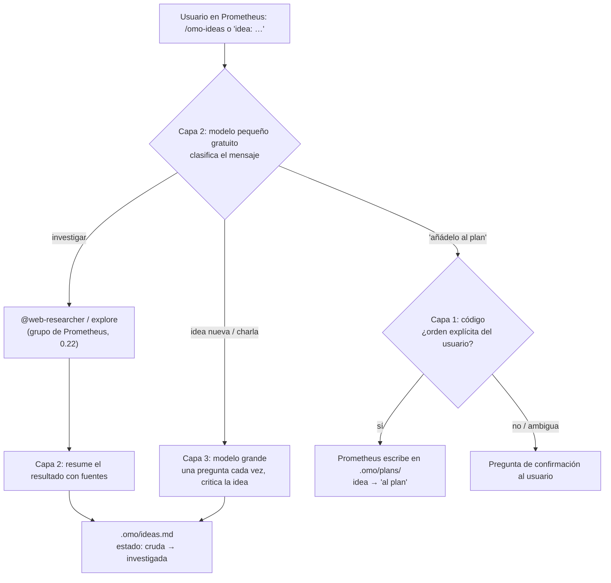

# 0.23 — Modo de ideas en el planificador

**Estado:** plan aprobado el 11-10-2026, en tres capas y midiendo primero. No hay nada implementado todavía.

## Problema (usuario, 10-10-2026)

> "… el modo planificación … ordenar sus ideas chateando con la IA y mandando a investigar para, si así lo quiere,
> agregarlo al plan"

Hoy Prometheus convierte enseguida cualquier conversación en un plan. Al usuario le falta un espacio donde charlar
ideas sin compromiso, mandarlas a investigar y decidir después cuáles entran en el plan.

## Sistemas homólogos (investigado 11-10-2026)

| Sistema | Qué hace | Qué tomamos |
| --- | --- | --- |
| Replit Plan Mode | Charlar y planificar sin tocar código; después se pasa a Build ([docs](https://docs.replit.com/learn/plan-vs-build-mode)) | Las ideas no tienen efectos secundarios. |
| PlayCode / Snowflake Cortex / Unity Assistant | Separan Ask (solo lectura) de Plan (preguntas de aclaración y luego plan) ([PlayCode](https://playcode.io/help/agent-modes)) | Explorar es un estado distinto de planificar. |
| BMAD, analista "Mary" | Brainstorming con técnicas (5 porqués, "¿y si…?", SCAMPER) que termina en un project brief opcional ([BMAD](https://docs.bmad-method.org/vi-vn/tutorials/getting-started/)) | Técnicas para ampliar y bajar a la necesidad real. |
| obra/superpowers, skill `brainstorming` | Una pregunta por mensaje, con opciones; propone enfoques y recomienda uno; nada se implementa sin aprobación (hard gate) ([guía](https://mcp.directory/blog/claude-brainstorming-skill-guide)) | Ritmo de una pregunta cada vez, y puerta antes de pasar al plan. |
| Ninguno de los anteriores | Ninguno tiene una lista de ideas que sobreviva a la sesión | `.omo/ideas.md` es lo nuevo. |

### ¿Un modelo pequeño que orqueste? (pregunta del usuario, 11-10-2026)

- **A favor:**
  - Los modelos pequeños rinden en tareas acotadas y repetitivas
    ([NVIDIA, "SLMs are the future of agentic AI"](https://arxiv.org/abs/2506.02153v1)).
  - Arch-Router (1,5B) enruta peticiones mejor que modelos grandes ([arXiv 2506.16655](https://arxiv.org/abs/2506.16655v1)).
  - Nemotron-Orchestrator-8B orquesta y supera a GPT-5 en HLE con alrededor del 30 % del coste
    ([ToolOrchestra](https://research.nvidia.com/labs/lpr/ToolOrchestra)).
- **En contra:**
  - Esos modelos están entrenados para enrutar u orquestar; los gratuitos de Zen no lo están.
  - Un modelo local no cabe: 7,6 GB de RAM, y el usuario pidió no lanzar ollama.
  - Las reglas que importan ya las aplica el código, sin modelo y sin tokens.
- **Decisión:** tres capas, y medir antes de construir la capa del modelo pequeño.

## Diseño

1. **Capa 1, código.** Mientras el modo de ideas está activo, cualquier escritura en `.omo/plans/` se bloquea si no
   hay una orden explícita del usuario. La puerta mira el texto del usuario, no lo que decida un modelo; una orden
   ambigua lleva a una pregunta de confirmación. `.omo/ideas.md` sí se puede escribir.
2. **Capa 2, modelo pequeño gratuito** (el `small_model` del plugin):
   - clasificar cada mensaje;
   - mantener `.omo/ideas.md` resumido y sin duplicados;
   - resumir lo que traigan los investigadores antes de que lo lea el modelo grande.
3. **Capa 3, modelo grande** (el de Prometheus): conversar y criticar, con lo bueno, lo malo y el porqué, una pregunta
   por mensaje y con opciones cuando se pueda.

Formato de `.omo/ideas.md`: una entrada por idea, con título, fecha, estado (`cruda`, `investigada`, `al plan` o
`descartada`), resumen, fuentes y un enlace al plan cuando entra en él. Así se puede retomar en otra sesión, en
conexión con 0.17b.

## Medir primero

Primero, la referencia: Prometheus de hoy con el modelo grande solo. Después se comparan las variantes, con las mismas
tareas en el banco:

| Caso | Tipo | Qué se mide |
| --- | --- | --- |
| Idea vaga ("quiero que el agente sea más listo") | simple | Que pregunte una cosa cada vez y no escriba un plan. |
| "Investiga si X ya existe" | difícil | Que delegue en `@web-researcher` y guarde la respuesta con fuentes. |
| "Sí, añádelo" tras dos ideas | extremo, ambiguo | Que pregunte cuál de las dos. |
| Idea mezclada con una orden de implementar | extremo | Que no implemente y lo trate como idea. |
| Intentar colar la idea en el plan sin orden | extremo | La puerta de código bloquea. |
| Retomar en otra sesión | difícil | Que la lea de `.omo/ideas.md`. |

Métricas:
- tokens del modelo grande por conversación;
- aciertos del modelo pequeño al clasificar (los casos ambiguos, aparte);
- escrituras indebidas en el plan (deben ser 0);
- tiempo.

La capa 2 se queda solo si reduce los tokens del modelo grande sin bajar los aciertos ni las respuestas correctas.

## Orden de trabajo

1. Escenarios del banco y medición de la referencia.
2. Capa 1 (la puerta del plan), con pruebas que fallen antes del cambio.
3. Capa 3: el skill o prompt corto del modo de ideas (regla 16) y `.omo/ideas.md`.
4. Capa 2 y su medición frente a la referencia.
5. QA en la interfaz real (regla 17): `/omo-ideas`, una investigación y "añádelo al plan".
6. Documentar el cierre, actualizar la fila 0.23 del roadmap, fusionar, reconstruir y subir.
