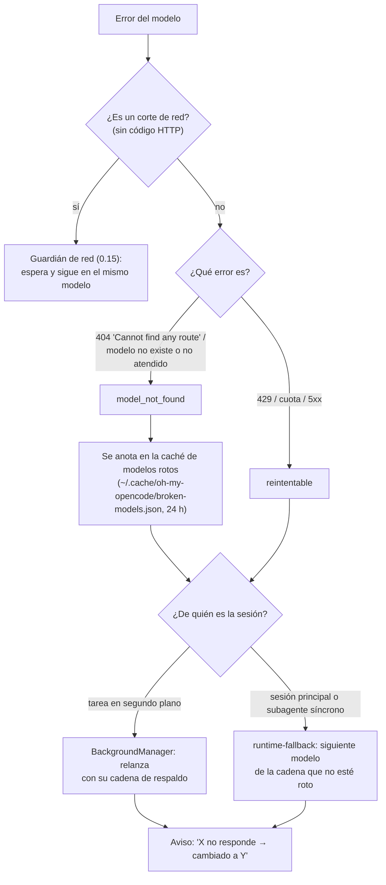
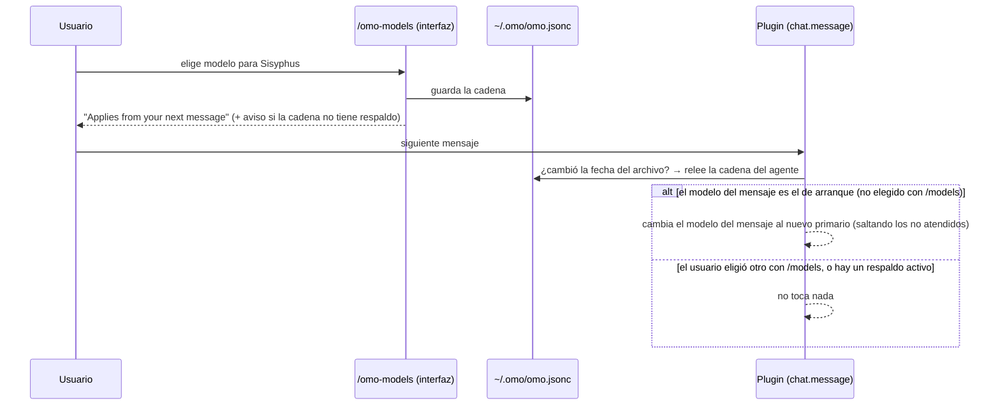
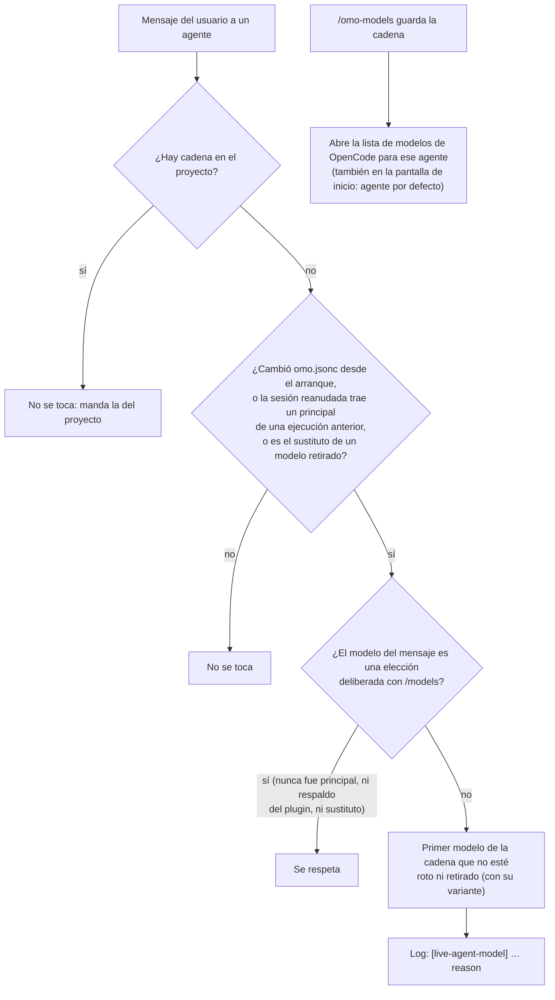

# Incidentes del uso real (07-10-2026)

Estado: **verificado en la interfaz real y con la configuración real (12-10-2026)**, en `fix/user-session-incidents`. Falta
la batería completa de resiliencia (cortada por RAM), el banco antes/después y la fusión. Ver "Cierre (12-10-2026)" al
final. `S/` = `packages/omo-opencode/src/`.
Sesión real: `ses_ee7fddc21ffee0KX6v5DYfkf7Z` (registros `/tmp/oh-my-opencode.log`, `~/.local/share/opencode/log/opencode.log`).

## A. Modelos
1. **`/omo-models` se aplica sin reiniciar** — nuevo `S/plugin/chat-message/live-agent-model.ts`: en cada mensaje del
   usuario comprueba la fecha de `~/.omo/omo.jsonc`; si cambió, relee la cadena del agente y cambia
   `output.message.model` **solo si** el primario configurado difiere del cargado al arrancar **y** el modelo del mensaje
   es el de arranque (una elección manual con `/models` nunca se pisa). En `S/features/omo-models/tui.ts`: el aviso
   pasa de "Reinicia OpenCode" a "se aplica desde tu próximo mensaje"; aviso si la cadena queda sin respaldo (1 modelo).
2. **Modelo listado pero no atendido** — clasificar 404 "Cannot find any route" / "model … not found|served|exist" como
   `model_not_found` (`packages/model-core/src/runtime-fallback-error-classifier.ts`), nunca como red; caché de modelos
   rotos (`~/.omo/cache/…`) que alimenta el selector ("no atendido") y la resolución de modelos; aviso "X no responde →
   cambiado a Y". Sondeo barato opcional: lista de modelos servidos de Zen si existe el endpoint, si no una petición de 1
   token al elegir un modelo gratuito en el selector (caché 24 h; sin red → "desconocido", nunca "roto").
3. **Respaldo encendido por defecto** (decisión del usuario): `runtime_fallback` y `model_fallback` activos por defecto
   para modelo no atendido, sin cuota o retirado; los cortes de red siguen el camino de 0.15 (esperar en el mismo modelo).
4. **Modelos retirados:** la sustitución al cargar ya existe; además `librarian`/`explore` deben recorrer sus
   `fallback_models` antes de caer al modelo de la sesión; las sustituciones pasan por la caché de rotos; acción para
   limpiar del `omo.jsonc` los modelos muertos (con copia).
5. **Modelo pequeño (títulos):** si `small_model` no está fijado y `prefer_free_models` está activo, se fija el primer
   modelo gratuito, atendido y no obsoleto; nunca se pisa un `small_model` explícito (si es de pago o roto, solo aviso).
   Adelanta 0.14 en lo que toca al modelo.

## B. Contexto (adelanta 0.13)
1. **Hecho (configuración del usuario):** reglas acotadas, 98k → 49k caracteres (~12k tokens por petición).
2. **Filtro de herramientas que no funcionaba** (`S/plugin-handlers/tool-config-handler.ts:68-80`: `config.tools` se
   convierte en permisos antes de los plugins) → pasar a `permission` deny.
3. **Orquestadores (Sisyphus, Atlas, Prometheus, Hephaestus) sin MCP** (`chrome-devtools_*`, `supabase_*`, `pencil_*`,
   `context7_*`, `grep_app_*`, `websearch_*`) ni `ctx_*` (decisión del usuario); los conservan los especialistas que
   los usan. Herramientas que no usan porque delegan: `lsp_*`, `ast_grep_*`, `process_*`, `monitor_*`,
   `session_list/read/info`, `interactive_bash`, `look_at`, `skill_mcp` (se miden antes de dejarlo).
4. **Skills listados una sola vez** (`S/tools/skill/description-formatter.ts` repite la lista que OpenCode ya inyecta).
5. **Descripciones largas recortadas** (`task` 2,7k, `decision_record`).
6. **Registrador de contexto honesto:** todas las herramientas (no solo 8), agrupadas por origen, secciones partidas
   también por `## ` y etiquetas en mayúsculas.
7. **Medición:** sonda de contexto con la configuración real (sin coste de modelo) antes y después; banco
   (fix-integrity, loops-hard, explore, web-research-hard) antes y después: acierto y pass^k no pueden bajar.
   Objetivo del "hola": 38–45k con estos cortes; ~20–25k cuando las reglas y Sisyphus pasen a skills (regla 16).

## Implementación (08-10-2026, rama `fix/user-session-incidents`)

### Flujo: un modelo deja de responder

- **Respaldo encendido por defecto** (`runtime_fallback`; `model_fallback` queda de reserva y solo actúa si el primero se
  apaga): un solo camino activo, sin dobles reacciones. Las tareas en segundo plano las gestiona solo el
  BackgroundManager (registro `S/shared/background-session-owner.ts`); runtime-fallback se aparta para ellas.
- **Clasificador** (`packages/model-core/src/runtime-fallback-error-classifier.ts`): "Cannot find any route matching",
  "model … not found / not served / does not exist", "no such model", "unknown model" → `model_not_found`; un 404 genérico
  o "file not found" no; `isNetworkError` sigue siendo falso para todo lo que trae código HTTP.
- **Caché de modelos rotos** (`S/shared/broken-models-cache.ts`): la escriben runtime-fallback, model-fallback y las
  tareas en segundo plano; la leen las cadenas de respaldo (se saltan los rotos), el registro de agentes y el selector de
  `/omo-models` (etiqueta "not served"). Se relee en cada consulta porque la interfaz y el servidor son procesos distintos.
- Sondeo de Zen descartado: `GET /zen/v1/models` responde con 87 modelos **e incluye** `ling-3.0-flash-fin-free`, el que
  da 404: la lista no detecta este fallo; la fuente de verdad es el error real.

### Flujo: `/omo-models` se aplica sin reiniciar

- `S/plugin/chat-message/live-agent-model.ts` + `S/shared/loaded-agent-models.ts` (modelo de cada agente al arrancar).
  No pisa una configuración de proyecto ni una elección manual.

### Flujo: modelo pequeño para títulos
Al cargar la configuración (`S/plugin-handlers/small-model.ts`): si `small_model` no está fijado y está activo
`prefer_free_models`, se fija un modelo gratuito, atendido y no obsoleto (primero los de Zen con nombres pequeños: nano,
mini, flash, lightning…); **nunca** uno de pago. Si el usuario fijó uno explícito, no se toca: si es de pago o no
responde, solo se avisa al arrancar.

### Modelos retirados
La sustitución al cargar ya existía. Corrección del diagnóstico inicial: `librarian` y `explore` **sí** usaban sus
respaldos; en el incidente, los tres modelos de su cadena estaban retirados. Añadido: las sustituciones se saltan los no
atendidos, el aviso de arranque dice "listado pero no atendido", y `oh-my-openagent config models --prune` limpia de
`omo.jsonc` los modelos muertos (con copia de seguridad).

### Contexto (lo hecho en el plugin)
- **Filtro de herramientas que no funcionaba** → ahora por permisos (`S/plugin-handlers/tool-config-handler.ts`).
- **Orquestadores** (Sisyphus, Atlas, Prometheus, Hephaestus) sin herramientas de MCP (`chrome-devtools_*`,
  `supabase_*`, `pencil_*`, `context7_*`, `grep_app_*`, `websearch_*`) ni `ctx_*`; tras el interruptor
  `context_budget.orchestrator_minimal_tools` (activo) tampoco ven `lsp_*` (salvo `lsp_diagnostics`), `ast_grep_*`,
  `session_list`, `session_info`, `look_at`. Se conservan a propósito, con su motivo: `lsp_diagnostics`,
  `interactive_bash`, `skill_mcp`, `session_read`, `process_*`, `monitor_*`. Los especialistas conservan todo.
- **Skills listados una sola vez** (`S/tools/skill/description-formatter.ts`). **Corrección (12-10-2026):** la cifra que
  figuraba aquí (38.914 → 9.378 caracteres) salió de una prueba unitaria, no de lo que recibe el modelo. La sonda con la
  configuración real mostró que el recorte **nunca llegaba**: seguía en 38.765 caracteres y 81 entradas. Causa y arreglo
  en "Cierre (12-10-2026)".
- **Descripciones recortadas:** `task` 4.721 → 3.667 caracteres; `decision_record` 810 → 457.
- **Registrador de contexto** del banco: todas las herramientas, agrupadas por origen, y secciones partidas también por
  `## ` y etiquetas en mayúsculas.
- **Configuración del usuario** (hecho antes): reglas de `ai-guidelines` 98k → 49k caracteres (~12k tokens).

### Pruebas que lo cierran
| Arreglo | Prueba que fallaba antes | Ahora |
|---|---|---|
| `/omo-models` en vivo | `tui.test.ts` 3 fallos (aviso de reinicio, sin aviso de cadena sin respaldo, sin etiqueta "not served"); `live-agent-model.test.ts` (módulo nuevo) | 7/7, 6/6, `chat-message` 38/38 |
| 404 no atendido | `runtime-fallback-model-not-served.test.ts` 2 de 3 | 3/3; clasificadores 13/13, 55/55, 31/31 |
| Respaldo por defecto | `default-on-incidents.test.ts` 0/3; `create-session-hooks` 1 fallo | 3/3, 7/7; `network-cut` 5/5, `runtime-fallback/index` 67/67 |
| Un solo respaldo en segundo plano | `background-session-owner.test.ts`: el 404 disparaba también runtime-fallback (1 en vez de 0) | 3/3; `fallback-retry-handler` 29/29 |
| Retirados / limpieza | `not-served-models.test.ts` 2 de 3; `prune.test.ts` 1 | 3/3, 1/1 |
| Modelo de títulos | `small-model.test.ts` (módulo nuevo) | 4/4; `config-handler` 52/52 |
| Herramientas por permisos y orquestadores | `tool-config-handler-context-budget.test.ts`: 18 de 21 fallaban | 21/21 |
| Skills una vez | `description-formatter.formatting.test.ts` | pasa |
| Descripciones | topes de longitud (4706 y 763 > límite) | pasan |
| Registrador | `context-proxy.test.ts` (función nueva) | 7/7 |

- **Suite de lo tocado:** chequeo de tipos limpio; **450 archivos de prueba** de las carpetas cambiadas, uno a uno: todos
  en verde (dos aserciones ajustadas porque buscaban la redacción antigua de la descripción de `task`). El fallo del
  chequeo de tipos de `packages/prompts-core` es previo (paquete idéntico en `mis-mejoras`).
- **Pendiente antes de cerrar:** sonda de contexto con la configuración real (antes/después, script
  `script/fork/qa/context-probe.ts`), banco antes/después para comprobar que no se pierde eficacia, y QA aislada (modelo
  que da 404 → respaldo con aviso; `/omo-models` aplicado en el siguiente mensaje; título con modelo gratuito). Todo
  espera memoria libre (regla de 3 GB para el otro agente).

## `/omo-models` ignorado en la interfaz real (investigación 10-10-2026, código de OpenCode 1.18.26)
- **La interfaz elige el modelo por su cuenta y siempre lo manda** (`packages/tui/src/context/local.tsx:236-245`):
  elección en memoria por agente (la de `/models`, `--model`, ciclos de recientes o el último mensaje de una sesión
  reanudada) → modelo del agente en el servidor → `config.model` / `recent[0]` / el del proveedor. El servidor usa
  `input.model ?? ag.model` (`session/prompt.ts:646`): la configuración del agente casi nunca cuenta.
- La interfaz relee los agentes del servidor solo cuando la instancia se reinicia; no hay forma soportada de que un
  plugin fije su modelo; sí puede abrir el selector nativo (`dispatchCommand("model.list")`).
- **El arreglo de esta rama nunca llegó al plugin que carga OpenCode** (dist del 05-10) y, además, su condición
  ("el modelo del mensaje es el de arranque") falla cuando la interfaz manda `recent[0]`, el modelo fijado de una sesión
  reanudada o uno de respaldo; y perdía la variante (en 1.18.26 va dentro de `model`).
- **Modelos retirados en la configuración del usuario** (`deepseek-v4-flash-free` en Atlas y otros): la interfaz los
  descarta y usa `recent[0]` (por eso Atlas usó `ling-3.0-flash-fin-free`).
- Registros reales: `/omo-models` guardó `sisyphus → ling-3.1-flash-free` y `prometheus → mimo-v2.6-flash-free` a las
  17:02Z del 09-10; `ling-3.1` no aparece nunca en el registro de OpenCode; `mimo-v2.6` aparece cuando el usuario lo
  eligió con `/models`.
- **Arreglo (en curso):** (1) ajuste por mensaje con la condición corregida (cambia salvo que el modelo del mensaje sea
  una elección deliberada del usuario) y la variante dentro de `model`; (2) al guardar en `/omo-models`, aviso y apertura
  del selector nativo para confirmar, así la interfaz lo fija con su propio mecanismo; (3) aviso de modelos retirados en
  las cadenas y acción para limpiarlos. **Verificación obligatoria en la interfaz real** (regla 17): tmux + registros de
  OpenCode (`script/fork/qa/tui-driver.ts`), con casos: cambio normal, elección deliberada con `/models` que se respeta,
  sesión reanudada y agente con modelo retirado.
- **Configuración del usuario corregida (10-10-2026, con su permiso):** quitados de `~/.omo/omo.jsonc` los modelos
  retirados (`deepseek-v4-flash-free`, `north-mini-code-free`, `laguna-s-2.1-free`, `mimo-v2.5-free`, presentes en 17 de
  19 cadenas; 5 cadenas se habían quedado sin ningún modelo vivo). Todas las cadenas tienen ahora principal + respaldo
  gratuitos y activos: `sisyphus` ling-3.1-flash-free → big-pickle, `prometheus` mimo-v2.6-flash-free → big-pickle, el
  resto big-pickle → nemotron-3.5-lightning-free. Copia: `~/.omo/omo.jsonc.bak.2026-10-10-retired-models`. Surte efecto
  al reiniciar OpenCode.

## Cierre (12-10-2026): prueba real, fallos encontrados y evidencia

### Cómo se verificó (regla 17)
- **Interfaz real** (`script/fork/qa/omo-models-tui.ts`): OpenCode 1.18.26 real en un tmux privado y un entorno XDG
  aislado. Escribe como el usuario y lee del **log propio de OpenCode** el modelo usado en cada mensaje: cada línea
  `message=process … messageID` va seguida de su `stream modelID=…`, así que los reintentos de un turno anterior no se
  confunden con la respuesta. Se exige que la mitad de servidor del plugin haya cargado (línea `Built tool registry`).
- **Contexto con la configuración real** (`script/fork/qa/context-probe.ts`): tu `opencode.json`, `AGENTS.md`, skills,
  MCP y `omo.jsonc` contra un Zen simulado que no cuesta nada.
- **QA aislada** (`script/fork/qa/resilience.ts`): proxy de Zen que rechaza modelos de pago y simula modelos muertos.
- **Batería de pruebas:** el paquete entero, archivo por archivo y cada carpeta en un solo proceso, como `test:fast`.

### Flujo final de `/omo-models`

El historial de principales por agente se guarda en `~/.cache/oh-my-opencode/agent-primary-history.json` (últimos 20).

### Resultados en la interfaz real (`.omo/evidence/omo-models-tui/1791839579229/`)
| Caso | Evidencia del log de OpenCode y del plugin |
|---|---|
| 1. Cambio en vivo | mensaje 1 → `big-pickle`; plugin `reason "chain changed"`; mensaje 2 → `nemotron-3.5-lightning-free` |
| 2. Sesión reanudada (`--continue`) | plugin `from nemotron to mimo-v2.6-flash-free, reason "resumed session"`; mensaje → `mimo-v2.6-flash-free` |
| 3. Elección con `/models` | elegido "Nemotron 3 Ultra" en el diálogo nativo → mensaje con `nemotron-3-ultra-free`; el plugin no actúa |
| 4. Modelo retirado | cadena `glm-5-free` (retirado) → `nemotron`: plugin `reason "configured model retired"`; stream `nemotron-3.5-lightning-free` |
| 5. Diálogo `/omo-models` | cadena guardada en `omo.jsonc` y lista "Select model" abierta |

### Contexto de un "hola" con la configuración real
| | `mis-mejoras` | Esta rama |
|---|---|---|
| Total | 74.194 tokens | **48.299 (−35 %)** |
| Herramientas de Sisyphus | 89 (39.402 tokens) | 33 (13.704) |
| Descripción de `skill` | 38.765 caracteres, 81 entradas | 8.231 caracteres, 23 entradas |

Ninguna skill quedó inalcanzable: las 43 nativas siguen en `<available_skills>` y las 15 copias `synced/<id>/x` tienen
su nombre corto ahí. Evidencia: `.omo/evidence/incidents/context-probe*.json`, con los cuerpos de petición en
`context-bodies-2/` y `context-bodies-3/`.

### Fallos que solo encontró la prueba real (todos corregidos con una prueba que fallaba antes)
| Fallo | Causa | Arreglo | Prueba |
|---|---|---|---|
| Con un modelo retirado se usaba el modelo por defecto de OpenCode | En el primer arranque el plugin no tiene la lista de modelos, conserva el retirado, y la interfaz manda su modelo por defecto | `live-agent-model` sustituye a ese sustituto por el siguiente de la cadena en cada mensaje | `live-agent-model.test.ts`: 2 nuevas |
| `/omo-models` no abría la lista en la pantalla de inicio | Sin sesión, no sabía cuál era el agente activo | Agente por defecto de la configuración; el aviso nombra el agente | `tui.test.ts`: 2 nuevas |
| Skills repetidas (nunca funcionó) | OpenCode copia la descripción una vez al registrar (`tool/registry.ts:142`); el plugin pedía la lista nativa mientras OpenCode arrancaba, y el error se tragaba en un `catch` vacío | `tool.definition` (por petición, `registry.ts:318`) da la descripción viva y carga la lista nativa si falta (3 s como máximo); el error se registra; también faltaba un `import` | `native-late.test.ts` 2, `tool-definition-skill.test.ts` 2 |
| La tarea se paraba con un modelo no atendido | Carrera entre `session.error` y `message.updated`: el segundo creaba un estado nuevo con una lectura antigua y dejaba huérfano el reintento del primero ("stale fallback generation") | `message.updated` vuelve a leer el estado tras su espera y no toca un salto en marcha | `message-update-handler.test.ts`: 1 nueva |
| Los títulos iban a un modelo listado pero no atendido | El selector tomaba el primer gratuito "rápido" en el orden de la caché | Prefiere los modelos de las cadenas del usuario | `small-model.test.ts`: 2 nuevas |
| 65 pruebas fallaban al correr juntas | El ayudante de simulacros cortaba la ruta en el primer espacio ("mejoras opencode") | Lee la ruta completa | `module-mock-lifecycle.test.ts`: 1 nueva; `runtime-fallback` 299/299 en un proceso |
| Dos suites de los hooks de Claude Code fallaban solas | Simulacros incompletos e import por el índice general | Simulacros con las exportaciones reales; import directo | 3/3 y 2/2 |
| La auditoría de simulacros necesitaba más de 2 GB | Analizaba los ~1.200 archivos de prueba a la vez | Filtra por texto y analiza solo los candidatos (un archivo trampa la sigue haciendo fallar) | 1/1, unos 1,2 GB |

También se corrigió el arnés de QA:
- el dist necesita `skills/` junto a `index.js`, porque OpenCode descarta en silencio un plugin que no se importa;
- los reintentos no se toman por respuestas;
- se comprueba que el diálogo de `/models` abre;
- se descarta `ling` (73 % de fallos de Zen);
- el umbral de RAM es configurable;
- un caso que falla no oculta los demás;
- la prueba de títulos usa su propia sesión sin título.

### QA aislada (`.omo/evidence/incidents/resilience-2`, `resilience-3`)
- **`omo-models-live`:** PASA; el siguiente mensaje usa el modelo de `omo.jsonc`.
- **`model-not-served`:** PASA. Prueba el modelo muerto, salta a `big-pickle`, termina la tarea con las pruebas en
  verde, recuerda el modelo como no atendido y avisa del salto.
- **`title-free-model`:** PASA. Se genera 1 título, con `big-pickle`, y ninguna petición de pago.

### Batería de pruebas
- **Paquete `omo-opencode`:** 1.130 archivos de uno en uno, 0 fallos; además, 162 carpetas en un solo proceso cada una,
  8.279 pruebas y 0 fallos.
- **Otros paquetes:** `model-core` 492/492, `script/fork` 88/88, esquemas 7/7.
- **Tipos:** `tsgo` del paquete, 0 errores.

### Límites conocidos
- La barra inferior de la interfaz muestra el modelo que la interfaz eligió hasta que se confirma en la lista que se
  abre. La API de plugins no permite cambiarla.
- Un cambio de agente con Tab en la pantalla de inicio no es visible para la API: la lista se abre para el agente por
  defecto, y el aviso dice para cuál.
- Si un modelo muerto está en tus cadenas, en el primer arranque puede elegirse para los títulos. En cuanto falla, la
  caché de no atendidos lo marca y deja de usarse.

### Cierre final (20/21-10-2026): banco, QA y pruebas

**Banco antes/después** (mismo modelo gratuito `big-pickle`, mismo día para cada par; resultados en `.omo/evals/`):

| Serie | Pasan a la primera | pass^3 | Tokens/ejecución | Turnos | Fallos de infraestructura |
|---|---|---|---|---|---|
| `fix-integrity` antes (14-10, `dist-base`) | 34/36 (94,4 %) | 83,3 % | 77.367 | 12,0 | 4 |
| `fix-integrity` después (14-10) | 35/36 (97,2 %) | 91,7 % | 35.846 (−54 %) | 10,1 | 1 |
| `fix-integrity` final (20-10, con todos los arreglos) | 35/36 (97,2 %) | 91,7 % | 43.322 | 9,0 | 2 (red) |
| `explore` antes (20-10, `dist-base`) | 41/51 (80,4 %) | 58,8 % | 25.681 | 5,9 | 1 |
| `explore` final (20-10) | 45/51 (88,2 %) | 70,6 % | 29.354 | 5,8 | 0 |

- **El único fallo de `fix-integrity` final** es `types-invoice-total` #2: el modelo metió un escape de tipos (H8), lo
  cubre el guardián de tipos de 0.9c (rama `feat/type-error-guard`). La primera vez esa ejecución la había invalidado
  el banco (H25); repetida con el banco arreglado, llega al final y falla por ese motivo.
- **`explore`**: +7,8 puntos a la primera y +11,8 en pass^3. Dos ejecuciones de la serie las rompió H26 (cortes de red
  con un subagente trabajando) con la versión sin arreglar; se guardan en
  `.omo/evidence/incidents/subagent-network/explore-after-with-h26-runs.jsonl` (44/51, 86,3 %) y se repitieron con el
  arreglo. Los fallos que quedan son del modelo: citas inventadas (`citationsExist`), líneas sin citar y no decir "no
  existe".
- **Tokens de `explore` (+14 %)**: el contexto base del plugin no cambió (las mismas secciones y el mismo rango de
  tokens de sistema, 1.201–17.243, en las dos series). La subida viene del trabajo: el historial medio crece un 7 % y se
  concentra en unas pocas tareas donde el agente hizo más llamadas (`codegen-dependency-rule` 8,7 → 12,3,
  `click-version-flow` 24,7 → 28,3), con más aciertos.
- **Memoria del servidor del banco**: estable entre ~600 y ~880 MB gracias a H4
  (`.omo/evidence/incidents/server-memory/final-bench-rss.tsv`).

**Batería de resiliencia completa** (12 escenarios, OpenCode real aislado, red simulada con un proxy;
`.omo/evidence/incidents/resilience-final/`): todos pasan con la versión final. `cut-short`, `cut-long`, `freeze`,
`kill`, `header-hold`, `cut-subagent` (nuevo, H26), `omo-models-live`, `project-disables-guard`, `guard-shell` y
`title-free-model` a la primera. `model-not-served` falló dos veces y destapó H29 (escenario caducado) y H30 (fallo del
plugin); con los dos arreglados pasa. `kill-other-request` falló una vez y destapó H28; con la nota nueva pasa 3/3. Base de datos real de OpenCode sin tocar en todas las ejecuciones (541 → 541).

**Pruebas**: 10.025 pruebas, 0 fallos (`omo-opencode` carpeta por carpeta, `lsp-core`, `model-core` y el banco
`script/fork`), en `.omo/evidence/incidents/package-tests-final.txt`; tipos del paquete y de `script/` sin errores.

**Fusión** (21-10-2026, pedida por el usuario): en `mis-mejoras` con `--no-ff`, `dist/` real reconstruido con el shim y
probado en OpenCode real aislado antes de subir. Al reconstruir, el paquete de Senpi sale distinto con Bun 1.4.3 (H16):
se deja el versionado, generado con 1.4.2.

## Hallazgos del banco y de la QA (14–19-10-2026) — se cierran todos antes de fusionar
Nota: H20 se retiró (era un error al lanzar la autocomprobación sin `codex` en el PATH). Regla del usuario (19-10-2026): todo fallo encontrado midiendo se arregla con su test en rojo y se documenta, aunque no
sea de esta rama ni lo hayan causado estos cambios. Estado de cada uno:

| # | Hallazgo | Causa | Arreglo / test | Estado |
|---|---|---|---|---|
| H1 | El banco contaba un corte de conexión (`getaddrinfo EAI_AGAIN`) y un turno sin respuesta del modelo como fallos de la tarea | patrones de infraestructura incompletos; un turno de 0 tokens sin error no se reconocía | `score.ts` (`isConnectivityError`, `silentModelError`), espera a que vuelva la conexión (`connectivity.ts`); tests en rojo y luego 97/97 | cerrado (`d5dd0face`) |
| H2 | La protección de tests no vigilaba la terminal: tras 5 ediciones rechazadas, el modelo cambió el test con `sed -i` (`impossible-round-half-even`, repetición 2, versión nueva) | solo miraba las herramientas de escritura | `shell-writes.ts`: copia antes de cada orden y deshace cambios en tests existentes; 23/23; escenario real `guard-shell` en `script/fork/qa/resilience.ts` | cerrado (`5cbf98d60`): QA real en OpenCode aislado con modelo gratuito, escenario `guard-shell` PASS (el modelo ejecutó `sed -i`, el test volvió a su estado, el modelo recibió el bloqueo, git sin cambios) y `project-disables-guard` sigue PASS; base de datos real 541 → 541 sesiones; `qa-1792509358515.jsonl` (sha256 389c1db254392da8…) |
| H3 | `boulder-state` no ejecutaba 2 de sus archivos de test | el script usaba `src/*.test.ts` (no recursivo); venía del proyecto original | glob recursivo; la auditoría de registro de paquetes pasa | cerrado (`e203e1ef8`) |
| H4 | El servidor de OpenCode del banco llegó a 1,6 GB tras 19 carpetas de tarea y lo cortó el límite de memoria | **medido** (`script/fork/qa/instance-memory.ts`, 19-10): sin trabajo, cada instancia cuesta ~3 MB sin plugin y ~7–8 MB con él (el plugin suma ~100 MB fijos al arrancar). Con el mismo trabajo real (6 tareas, agente `build`), OpenCode solo pasa de 305 a ~590 MB; con el plugin el servidor es parecido pero cada carpeta arranca dos procesos auxiliares: el proxy stdio de `lsp-daemon` (~60 MB, uno por instancia, porque OpenCode arranca un MCP local por instancia) y un servidor de lenguaje (~30–45 MB). Con 19 carpetas sin cerrar eso suma ~1,2 GB más | el banco tiene que cerrar la instancia de cada tarea (`instance.dispose`) para medir sin esa acumulación; cerrar una instancia ya libera su proxy (medido: 1.021 → 659 MB tras cerrar 6). Con la TUI (una carpeta) solo hay un proxy y un servidor de lenguaje | cerrado (`cd3d63d29`): el banco cierra la instancia de cada tarea; en el banco final el servidor se mantuvo entre ~600 y ~880 MB (`.omo/evidence/incidents/server-memory/final-bench-rss.tsv`) |
| H5 | Con la memoria alta, el plugin intentó guardar las sesiones para reanudarlas y falló siempre (`posix_spawn 'git'` ENOENT) | cada instancia vieja guarda en su carpeta, que ya no existe | un guardado por sesión, en su propio proyecto, y se para cuando OpenCode cierra la instancia; test en rojo con una carpeta borrada | cerrado (`63d973fcf`) |
| H6 | Ese guardado se lanzó 6 veces en el mismo milisegundo | un vigilante de memoria por instancia, todos con la misma lista de sesiones | un solo vigilante por proceso, y cada instancia guarda solo sus sesiones; test en rojo | cerrado (`63d973fcf`) |
| H7 | Tras 120 s sin cabeceras de Zen y 240 s de cuelgue, la sesión siguió con `nemotron-3.5-lightning-free` en vez de `big-pickle` | **a propósito** (0.15, `hooks/stall-watchdog/hook.ts`): un modelo que deja de responder se cambia por el siguiente de la cadena; si la causa es la red, sigue con el mismo | sin cambio de código; el daño (ese modelo se saltó la protección) lo cierra H2 | cerrado: es el diseño |
| H8 | `types-invoice-total` (versión anterior, repetición 1): el modelo metió un cast que escapa del sistema de tipos | comportamiento del modelo | lo cubre 0.9c (guardián de tipos, rama `feat/type-error-guard`): se comprueba en su banco | a comprobar en 0.9c |
| H9 | En los registros reales del usuario: 9 "Rate limit exceeded" de `big-pickle` (15–16-10); la sesión se quedó parada y 12 min después seguía en `big-pickle` | su plugin instalado (05-10) tenía el cambio de modelo en caliente apagado; esta rama lo enciende por defecto (A3) | comprobado con el clasificador real: "Rate limit exceeded" se reintenta con y sin código 429; le llega al usuario al fusionar | cerrado (le llega al fusionar) |
| H12 | Al cerrar OpenCode una instancia (lo hace al llamar a su `dispose`), el plugin no paraba sus temporizadores: reanudación, guardia de red, seguimiento de interrupciones, vigilante de cuelgues y freno de bucles solo se paraban al apagar el proceso | `plugin-dispose.ts` y `disposeCreatedHooks` no los llamaban | todos se paran en el `dispose` de su instancia y quitan solo lo suyo; tests en rojo (`plugin-dispose.test.ts`, `interruption/plugin.test.ts`) | cerrado (`63d973fcf`, `d683c4b9e`) |
| H13 | Ocho objetos del plugin eran "uno por proceso" (reanudación, notas de interrupción, guardia de red, avisos de tareas, vigilante de cuelgues, freno de bucles, procesos gestionados, investigación web): con varias carpetas en el mismo servidor, la última instancia pisaba a las demás, los avisos salían por el cliente de otra carpeta y el `dispose` del vigilante de cuelgues borraba el de la instancia viva | el plugin suponía una instancia por proceso; vale para la TUI, no para la app de escritorio, la web ni el banco | registro por carpeta (`shared/instance-registry.ts`); cada lectura pasa su carpeta; SIGTERM llega a todas las instancias vivas; tests en rojo con dos carpetas por objeto; 4.079/4.079 en los 445 archivos tocados | cerrado (`d683c4b9e`) |
| H14 | Al cerrar las instancias, sus servidores de lenguaje (`deno lsp`) seguían vivos dentro de `lsp-daemon` | **a propósito:** `lsp-core` cierra un servidor de lenguaje tras 5 min sin uso (`IDLE_TIMEOUT_MS`, `lsp/manager.ts`); la medición fue antes de ese plazo | sin cambio de código | cerrado: es el diseño |
| H15 | En un proyecto Bun/Node, los `.ts` los revisaba `deno lsp` | `typescript-language-server` no está instalado en esta máquina y Deno sí; `findServerForExtension` cogía el primer servidor instalado para la extensión, sin mirar si el proyecto es de Deno, y Deno aplica otras reglas de módulos (diagnósticos engañosos para el agente) | `deno lsp` solo en proyectos con `deno.json`/`deno.jsonc` (buscando hacia arriba); si no hay servidor de TypeScript, el agente recibe la pista para instalarlo; test en rojo (`server-resolution-deno.test.ts`), luego 171 tests de `lsp-core`. Afecta también a Codex y Senpi: hay que reconstruir `lsp-daemon`, `lsp-tools-mcp` y el paquete de Senpi (versionado) y pasar sus puertas | cerrado (`6f45cbcb8`) |
| H16 | El paquete de Senpi versionado (`packages/omo-senpi/plugin/extensions/*.js`) estaba desfasado en esta rama: llevaba el código de `model-core` de antes de los arreglos de modelos (no tenía "user model no longer offered; trying other models"); la comprobación de Senpi de CI habría fallado | los commits anteriores de la rama cambiaron `model-core` sin regenerar el paquete | regenerado con la misma versión de Bun que usa CI (1.4.2, descargada y comprobada con su suma) y las dos comprobaciones (`build-extension.mjs --check`, `build-install.mjs --check`) pasan; con Bun 1.4.3 el resultado difiere byte a byte y la comprobación compara bytes | cerrado (`6f45cbcb8`) |
| H17 | La QA en vivo de Senpi (`lsp-e2e.mjs`) fallaba en `oneWarning` y `multiFileBlocks` de la inspección dentro del proceso | **tres causas:** (1) un servidor de lenguaje que se cierra al arrancar dejaba `initialize` esperando 60 s (30 s por el daemon), porque `JsonRpcConnection` no rechazaba las peticiones pendientes al cerrarse la salida, y se perdían los diagnósticos de los demás archivos del lote; (2) la inspección no emitía el "primer pintado" (`input`) del que depende el aviso diferido desde el 17-09-2026; (3) H22 | (1) las peticiones pendientes fallan al cerrarse la salida (60.112 ms → 90 ms) y `EPIPE` cuenta como conexión cerrada; test `json-rpc-connection-close.test.ts` (en rojo se quedaba colgado); (2) `emitFirstPaint` en las dos inspecciones; QA en vivo de Senpi completa: PASS (`.omo/evidence/omo-senpi-adapter/20261020-lsp-final/`) | cerrado |
| H18 | `bun run test:senpi`: 13 fallos y 1 error en `build-extension.test.mjs` | **carga de la máquina, no el código:** con la cola de Blender en pausa pasan los 15 tests del archivo y la batería entera (3.933 + 10, 0 fallos) | sin cambio; no se subió el límite | cerrado: era la carga |
| H19 | La QA en vivo de Codex (`codex-qa/scripts/lsp-e2e.sh`) fallaba en `openCodeMcpEnvInputs` | el script esperaba 3 variables de entorno del MCP de LSP, pero el proyecto original añadió `LSP_TOOLS_MCP_CWD` el 29-08-2026 (999c57113) | el script la espera y comprueba que apunta al proyecto; autocomprobación PASS; `post-edit` en vivo PASS | cerrado |
| H21 | La misma QA de Codex no escribía su resultado ("argument list too long") con muchos archivos sin seguimiento | pasaba el listado completo de `git status -uall` como un solo argumento (139 KB); Linux limita cada argumento a 128 KiB (`MAX_ARG_STRLEN`) | pasa su huella SHA-256 (solo se comparaban por igualdad); `rename` en vivo PASS | cerrado |
| H22 | Con el servidor de TypeScript recién arrancado, los diagnósticos decían "sin errores" para un archivo con errores (6 de 16 respuestas vacías con el servidor real) | `lsp-core` esperaba 3 s y, si el servidor no había publicado, aplicaba la regla "silencio = limpio" (pensada para servidores como Marksman); `typescript-language-server` no tiene diagnósticos bajo petición y, en frío, carga el proyecto 5–10 s antes de publicar | `lsp-core` anuncia `window.workDoneProgress`, sigue el `$/progress` del servidor y espera mientras está ocupado (máx. 60 s, y si se agota devuelve "no sé", nunca "limpio"); 1 s de margen para la publicación que llega justo tras el fin del progreso; un servidor de menos de 10 s que nunca publicó no cuenta como limpio. 5 tests con un servidor falso que imita al real (`client-diagnostics-busy-server.test.ts`), en rojo antes; 177 tests de `lsp-core`; con el servidor real, 16 de 16 respuestas con el error; los 3 tests de la regla de silencio fijan la espera inicial a 0 de forma explícita | cerrado |
| H24 | En los cortes de red, el banco muestra un `TypeError: ECONNRESET` en bruto | el corte llega a mitad de una respuesta en streaming: el proxy del banco ya pasó las cabeceras y Bun registra el error del flujo | sin cambio: el efecto es el correcto (OpenCode recibe la conexión cortada y el banco marca la ejecución como de conexión y la repite, visto el 19 y el 20-10); terminar el flujo "limpio" escondería el corte. Solo afecta a la salida de consola de una herramienta de pruebas | cerrado: es la herramienta mostrando el corte |
| H25 | En la serie final, `types-invoice-total` #2 se dio por fallada con 3 turnos: el agente había lanzado dos exploraciones en segundo plano y esperaba | el banco daba una tarea por terminada tras 5 s de reposo de la sesión principal sin mirar sus subagentes; esperó 8 s, el banco la abortó y la calificó a medias, y el plugin sí la despertó ("Sent deferred parent wake", siguió hasta el paso 16) | `session-tree.ts`: no se da por terminada mientras algún subagente siga trabajando; test en rojo y luego 102/102 en `script/fork`. Impacto medido: solo esa ejecución (las series del 14-10 no tienen otra fallada con delegación en segundo plano); se reclasifica como fallo del banco (copia original en la evidencia) y se repite con el banco arreglado | cerrado: repetida con el banco arreglado, esa ejecución ya llega al final; falla por otro motivo, un escape de tipos en `src/sum.ts`, que es H8 y lo cubre 0.9c |
| H26 | En la serie de exploración nueva, `fork-paid-model` #1 y `fork-compaction-flow` #1 acabaron con la respuesta vacía tras cortes de red reales | el vigilante de red (0.15), al volver la red, paraba el turno colgado del subagente para mandarle "sigue". Pero quien delegó (el `task` de OpenCode, el de `@explore` o el de los orquestadores) espera a que ese turno termine: pararlo le devolvía una respuesta vacía, y el "sigue" trabajaba para nadie. Lo confirman los registros de OpenCode (cancelación del hijo 20:23:57.391, el padre sigue 31 ms después, el hijo retoma 260 ms después) y, en la prueba real sin el arreglo, el orquestador tuvo que volver a delegar desde cero | el vigilante ya no para ni continúa a un subagente que alguien espera: deja que OpenCode reintente solo (su reintento y sus tiempos de espera recuperan la conexión). Solo continúa una tarea en segundo plano cuando OpenCode ya se rindió, porque su gestor sigue esperando. Tests en rojo y luego 59/59 en el vigilante y 68/68 con los hooks; escenario real `cut-subagent` en `script/fork/qa/resilience.ts` con una red "a oscuras" (las conexiones abiertas durante el corte quedan muertas, como un socket real). QA real (20-10): sin el arreglo FALLA (el vigilante cancela al subagente 2 veces y quien lo llamó recibe una respuesta vacía); con el arreglo PASA (0 cancelaciones; OpenCode reintenta solo al acabar su espera de cabeceras de 2 min y quien llamó recibe la respuesta real, con citas `archivo:línea`); base de datos real 541 → 541; evidencia `.omo/evidence/incidents/subagent-network/` | **cerrado** |
| H27 | Una QA de resiliencia parada para dejar hueco a otro agente dejó su sandbox en `/tmp`, con su copia de `auth.json` | `systemctl stop` del ámbito (el guardián de RAM o un hueco pedido) manda SIGTERM, y `resilience.ts`, `context-probe.ts` y `tui-driver.ts` (y con él `omo-models-tui.ts`) morían antes de su `finally`; solo el banco limpiaba al recibir la señal | `onStopSignal` en `script/fork/bench/sandbox.ts` (limpia una vez y sale con 130), usado por los tres; test con un proceso real al que se manda SIGTERM, en rojo y luego 8/8. Probado de verdad (21-10): una QA de resiliencia parada con `systemctl stop` salió con 130 y no dejó sandbox. Límite: un SIGKILL no se puede atender, así que una QA se para siempre por su ámbito (SIGTERM) antes de parar la tarea | **cerrado** |
| H28 | En la batería final, `kill-other-request` falló: tras matar OpenCode, el usuario pide otra cosa ("solo responde el número") y el modelo contestó "1" sin decir que el trabajo anterior quedó a medias (las dos veces anteriores sí lo dijo) | la nota de trabajo cortado sí llegó al mensaje (comprobado en la base del sandbox); el modelo gratuito obedeció "solo el número" por encima de la regla de la nota. El plugin además ya avisa al usuario con un toast "Trabajo cortado" al recuperar el trabajo, sin depender del modelo | la regla de la nota dice ahora que añada esa línea aunque el usuario pida una respuesta corta, porque necesita saber que quedó a medias; el escenario comprueba además, de forma determinista, que la nota viajó en el mensaje. Con la nota nueva: 2/2 PASA ("1" y "(El trabajo anterior sobre los tests quedó cortado; puedes retomarlo cuando quieras.)"; "1" y "(The earlier work was cut mid-way… say continúa to resume it.)"); con la anterior falló 1 de 3. Tercera repetición (21-10): PASA ("1 (el trabajo anterior de arreglar los tests quedó suspendido y se puede retomar)"), 3/3 | **cerrado** |
| H29 | En la batería final, `model-not-served` falló: Sisyphus nunca probó el modelo "muerto" y fue directo a `big-pickle` | el escenario usaba fijo `ling-3.0-flash-fin-free` (el del incidente del 07-10), que models.dev marcó después como retirado; el plugin lo sustituye al registrar los agentes y lo avisa (0.7), que es lo correcto, así que el escenario ya no probaba el camino del 404. No es un fallo del plugin sino un escenario caducado | el escenario elige al ejecutarse un modelo gratuito que el catálogo aún ofrece y el proxy le responde el 404 "no atendido"; así no vuelve a caducar | cerrado: `model-not-served` PASA (57 s) con el modelo elegido del catálogo y el arreglo de H30 |
| H30 | Con el escenario `model-not-served` ya arreglado (H29), el plugin saltó bien del modelo muerto a `big-pickle`, pero la tarea quedó a medias: el modelo había encontrado el fallo y su mensaje acabó abortado | tras pasar al modelo de respaldo, runtime-fallback arma un plazo de 30 s que solo se cancela cuando el modelo escribe **texto**. `big-pickle` trabajaba con herramientas (leer, ejecutar los tests) sin escribir texto todavía; a los 30 s el plugin lo abortó (cancelación 00:50:55, 30 s después del salto) y, sin más modelos en la cadena, no siguió nadie. Dependía del momento: el 12-10 el modelo escribió texto antes y pasó | una llamada a herramienta terminada (bien o con error) cuenta como respuesta del modelo; una pendiente todavía no. Tests en rojo y luego 302/302 en runtime-fallback; tipos limpios | cerrado: `model-not-served` PASA: prueba el modelo muerto, salta a `big-pickle`, lo recuerda, avisa y la tarea termina con los tests en verde |
| H11 | "Insufficient account funds" (modelo de pago sin saldo) no cambiaba a un modelo gratis | el patrón `insufficient.?funds` exige las palabras juntas | patrón ampliado (sigue cubriendo `insufficient_quota`); test con el texto exacto de Zen en rojo y luego 792/792 | cerrado |
| H10 | Tras un `ECONNRESET`, una tarea quedó 420 s parada antes de reintentarse | **no es un fallo del plugin:** de 22:54:45 a 22:58:09 no hubo internet (`getaddrinfo EAI_AGAIN`); el plugin hizo lo previsto ("network cut; leaving OpenCode's retry alone", mismo modelo, sin gastar intentos) y el vigilante del banco (420 s sin avance) canceló la ejecución, que se repitió al volver la red (H1) | sin cambio de código; registros en `.omo/evals/2026-10-14-fix-integrity-after-1792021058570-logs/` | cerrado: es la red |
