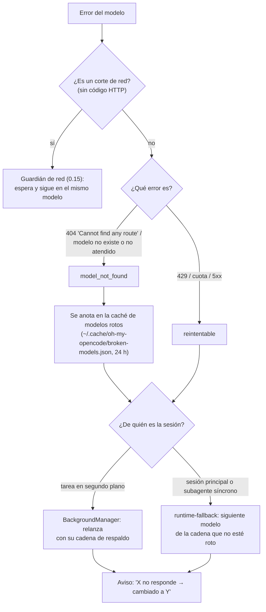
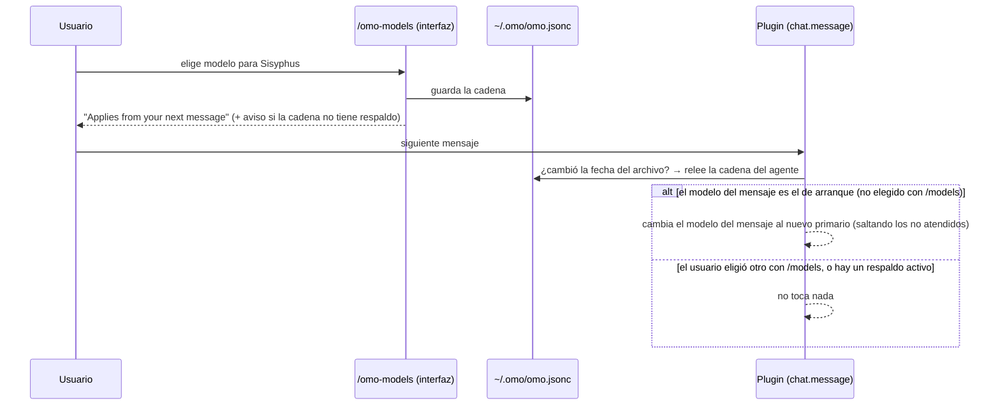

# Incidentes del uso real (07-10-2026)

Estado: **arreglos aprobados (07-10-2026), en curso** en `fix/user-session-incidents`. `S/` = `packages/omo-opencode/src/`.
Sesión real: `ses_ee7fddc21ffee0KX6v5DYfkf7Z` (registros `/tmp/oh-my-opencode.log`, `~/.local/share/opencode/log/opencode.log`).

## A. Modelos
1. **`/omo-models` se aplica sin reiniciar** — nuevo `S/plugin/chat-message/live-agent-model.ts`: en cada mensaje del
   usuario comprueba la fecha de `~/.omo/omo.jsonc`; si cambió, relee la cadena del agente y cambia
   `output.message.model` **solo si** el primario configurado difiere del cargado al arrancar **y** el modelo del mensaje
   es el de arranque (una elección manual con `/models` nunca se pisa). En `S/features/omo-models/tui.ts`: el aviso
   pasa de "Reinicia OpenCode" a "se aplica desde tu próximo mensaje"; aviso si la cadena queda sin respaldo (1 modelo).
2. **Modelo listado pero no atendido** — clasificar 404 "Cannot find any route" / "model … not found|served|exist" como
   `model_not_found` (`packages/model-core/src/runtime-fallback-error-classifier.ts`), nunca como red; caché de modelos
   rotos (`~/.omo/cache/…`) que alimenta el selector ("no atendido") y la resolución de modelos; aviso "X no responde →
   cambiado a Y". Sondeo barato opcional: lista de modelos servidos de Zen si existe el endpoint, si no una petición de 1
   token al elegir un modelo gratuito en el selector (caché 24 h; sin red → "desconocido", nunca "roto").
3. **Respaldo encendido por defecto** (decisión del usuario): `runtime_fallback` y `model_fallback` activos por defecto
   para modelo no atendido, sin cuota o retirado; los cortes de red siguen el camino de 0.15 (esperar en el mismo modelo).
4. **Modelos retirados:** la sustitución al cargar ya existe; además `librarian`/`explore` deben recorrer sus
   `fallback_models` antes de caer al modelo de la sesión; las sustituciones pasan por la caché de rotos; acción para
   limpiar del `omo.jsonc` los modelos muertos (con copia).
5. **Modelo pequeño (títulos):** si `small_model` no está fijado y `prefer_free_models` está activo, se fija el primer
   modelo gratuito, atendido y no obsoleto; nunca se pisa un `small_model` explícito (si es de pago o roto, solo aviso).
   Adelanta 0.14 en lo que toca al modelo.

## B. Contexto (adelanta 0.13)
1. **Hecho (configuración del usuario):** reglas acotadas, 98k → 49k caracteres (~12k tokens por petición).
2. **Filtro de herramientas que no funcionaba** (`S/plugin-handlers/tool-config-handler.ts:68-80`: `config.tools` se
   convierte en permisos antes de los plugins) → pasar a `permission` deny.
3. **Orquestadores (Sisyphus, Atlas, Prometheus, Hephaestus) sin MCP** (`chrome-devtools_*`, `supabase_*`, `pencil_*`,
   `context7_*`, `grep_app_*`, `websearch_*`) ni `ctx_*` (decisión del usuario); los conservan los especialistas que
   los usan. Herramientas que no usan porque delegan: `lsp_*`, `ast_grep_*`, `process_*`, `monitor_*`,
   `session_list/read/info`, `interactive_bash`, `look_at`, `skill_mcp` (se miden antes de dejarlo).
4. **Skills listados una sola vez** (`S/tools/skill/description-formatter.ts` repite la lista que OpenCode ya inyecta).
5. **Descripciones largas recortadas** (`task` 2,7k, `decision_record`).
6. **Registrador de contexto honesto:** todas las herramientas (no solo 8), agrupadas por origen, secciones partidas
   también por `## ` y etiquetas en mayúsculas.
7. **Medición:** sonda de contexto con la configuración real (sin coste de modelo) antes y después; banco
   (fix-integrity, loops-hard, explore, web-research-hard) antes y después: acierto y pass^k no pueden bajar.
   Objetivo del "hola": 38–45k con estos cortes; ~20–25k cuando las reglas y Sisyphus pasen a skills (regla 16).

## Implementación (08-10-2026, rama `fix/user-session-incidents`)

### Flujo: un modelo deja de responder

- **Respaldo encendido por defecto** (`runtime_fallback`; `model_fallback` queda de reserva y solo actúa si el primero se
  apaga): un solo camino activo, sin dobles reacciones. Las tareas en segundo plano las gestiona solo el
  BackgroundManager (registro `S/shared/background-session-owner.ts`); runtime-fallback se aparta para ellas.
- **Clasificador** (`packages/model-core/src/runtime-fallback-error-classifier.ts`): "Cannot find any route matching",
  "model … not found / not served / does not exist", "no such model", "unknown model" → `model_not_found`; un 404 genérico
  o "file not found" no; `isNetworkError` sigue siendo falso para todo lo que trae código HTTP.
- **Caché de modelos rotos** (`S/shared/broken-models-cache.ts`): la escriben runtime-fallback, model-fallback y las
  tareas en segundo plano; la leen las cadenas de respaldo (se saltan los rotos), el registro de agentes y el selector de
  `/omo-models` (etiqueta "not served"). Se relee en cada consulta porque la interfaz y el servidor son procesos distintos.
- Sondeo de Zen descartado: `GET /zen/v1/models` responde con 87 modelos **e incluye** `ling-3.0-flash-fin-free`, el que
  da 404: la lista no detecta este fallo; la fuente de verdad es el error real.

### Flujo: `/omo-models` se aplica sin reiniciar

- `S/plugin/chat-message/live-agent-model.ts` + `S/shared/loaded-agent-models.ts` (modelo de cada agente al arrancar).
  No pisa una configuración de proyecto ni una elección manual.

### Flujo: modelo pequeño para títulos
Al cargar la configuración (`S/plugin-handlers/small-model.ts`): si `small_model` no está fijado y está activo
`prefer_free_models`, se fija un modelo gratuito, atendido y no obsoleto (primero los de Zen con nombres pequeños: nano,
mini, flash, lightning…); **nunca** uno de pago. Si el usuario fijó uno explícito, no se toca: si es de pago o no
responde, solo se avisa al arrancar.

### Modelos retirados
La sustitución al cargar ya existía. Corrección del diagnóstico inicial: `librarian` y `explore` **sí** usaban sus
respaldos; en el incidente, los tres modelos de su cadena estaban retirados. Añadido: las sustituciones se saltan los no
atendidos, el aviso de arranque dice "listado pero no atendido", y `oh-my-openagent config models --prune` limpia de
`omo.jsonc` los modelos muertos (con copia de seguridad).

### Contexto (lo hecho en el plugin)
- **Filtro de herramientas que no funcionaba** → ahora por permisos (`S/plugin-handlers/tool-config-handler.ts`).
- **Orquestadores** (Sisyphus, Atlas, Prometheus, Hephaestus) sin herramientas de MCP (`chrome-devtools_*`,
  `supabase_*`, `pencil_*`, `context7_*`, `grep_app_*`, `websearch_*`) ni `ctx_*`; tras el interruptor
  `context_budget.orchestrator_minimal_tools` (activo) tampoco ven `lsp_*` (salvo `lsp_diagnostics`), `ast_grep_*`,
  `session_list`, `session_info`, `look_at`. Se conservan a propósito, con su motivo: `lsp_diagnostics`,
  `interactive_bash`, `skill_mcp`, `session_read`, `process_*`, `monitor_*`. Los especialistas conservan todo.
- **Skills listados una sola vez** (`S/tools/skill/description-formatter.ts`): medido con la configuración del usuario,
  la descripción pasa de 38.914 a 9.378 caracteres (**~7,4k tokens menos por petición** en cada agente con `skill`).
- **Descripciones recortadas:** `task` 4.721 → 3.667 caracteres; `decision_record` 810 → 457.
- **Registrador de contexto** del banco: todas las herramientas, agrupadas por origen, y secciones partidas también por
  `## ` y etiquetas en mayúsculas.
- **Configuración del usuario** (hecho antes): reglas de `ai-guidelines` 98k → 49k caracteres (~12k tokens).

### Pruebas que lo cierran
| Arreglo | Prueba que fallaba antes | Ahora |
|---|---|---|
| `/omo-models` en vivo | `tui.test.ts` 3 fallos (aviso de reinicio, sin aviso de cadena sin respaldo, sin etiqueta "not served"); `live-agent-model.test.ts` (módulo nuevo) | 7/7, 6/6, `chat-message` 38/38 |
| 404 no atendido | `runtime-fallback-model-not-served.test.ts` 2 de 3 | 3/3; clasificadores 13/13, 55/55, 31/31 |
| Respaldo por defecto | `default-on-incidents.test.ts` 0/3; `create-session-hooks` 1 fallo | 3/3, 7/7; `network-cut` 5/5, `runtime-fallback/index` 67/67 |
| Un solo respaldo en segundo plano | `background-session-owner.test.ts`: el 404 disparaba también runtime-fallback (1 en vez de 0) | 3/3; `fallback-retry-handler` 29/29 |
| Retirados / limpieza | `not-served-models.test.ts` 2 de 3; `prune.test.ts` 1 | 3/3, 1/1 |
| Modelo de títulos | `small-model.test.ts` (módulo nuevo) | 4/4; `config-handler` 52/52 |
| Herramientas por permisos y orquestadores | `tool-config-handler-context-budget.test.ts`: 18 de 21 fallaban | 21/21 |
| Skills una vez | `description-formatter.formatting.test.ts` | pasa |
| Descripciones | topes de longitud (4706 y 763 > límite) | pasan |
| Registrador | `context-proxy.test.ts` (función nueva) | 7/7 |

- **Suite de lo tocado:** chequeo de tipos limpio; **450 archivos de prueba** de las carpetas cambiadas, uno a uno: todos
  en verde (dos aserciones ajustadas porque buscaban la redacción antigua de la descripción de `task`). El fallo del
  chequeo de tipos de `packages/prompts-core` es previo (paquete idéntico en `mis-mejoras`).
- **Pendiente antes de cerrar:** sonda de contexto con la configuración real (antes/después, script
  `script/fork/qa/context-probe.ts`), banco antes/después para comprobar que no se pierde eficacia, y QA aislada (modelo
  que da 404 → respaldo con aviso; `/omo-models` aplicado en el siguiente mensaje; título con modelo gratuito). Todo
  espera memoria libre (regla de 3 GB para el otro agente).

## `/omo-models` ignorado en la interfaz real (investigación 10-10-2026, código de OpenCode 1.18.26)
- **La interfaz elige el modelo por su cuenta y siempre lo manda** (`packages/tui/src/context/local.tsx:236-245`):
  elección en memoria por agente (la de `/models`, `--model`, ciclos de recientes o el último mensaje de una sesión
  reanudada) → modelo del agente en el servidor → `config.model` / `recent[0]` / el del proveedor. El servidor usa
  `input.model ?? ag.model` (`session/prompt.ts:646`): la configuración del agente casi nunca cuenta.
- La interfaz relee los agentes del servidor solo cuando la instancia se reinicia; no hay forma soportada de que un
  plugin fije su modelo; sí puede abrir el selector nativo (`dispatchCommand("model.list")`).
- **El arreglo de esta rama nunca llegó al plugin que carga OpenCode** (dist del 05-10) y, además, su condición
  ("el modelo del mensaje es el de arranque") falla cuando la interfaz manda `recent[0]`, el modelo fijado de una sesión
  reanudada o uno de respaldo; y perdía la variante (en 1.18.26 va dentro de `model`).
- **Modelos retirados en la configuración del usuario** (`deepseek-v4-flash-free` en Atlas y otros): la interfaz los
  descarta y usa `recent[0]` (por eso Atlas usó `ling-3.0-flash-fin-free`).
- Registros reales: `/omo-models` guardó `sisyphus → ling-3.1-flash-free` y `prometheus → mimo-v2.6-flash-free` a las
  17:02Z del 09-10; `ling-3.1` no aparece nunca en el registro de OpenCode; `mimo-v2.6` aparece cuando el usuario lo
  eligió con `/models`.
- **Arreglo (en curso):** (1) ajuste por mensaje con la condición corregida (cambia salvo que el modelo del mensaje sea
  una elección deliberada del usuario) y la variante dentro de `model`; (2) al guardar en `/omo-models`, aviso y apertura
  del selector nativo para confirmar, así la interfaz lo fija con su propio mecanismo; (3) aviso de modelos retirados en
  las cadenas y acción para limpiarlos. **Verificación obligatoria en la interfaz real** (regla 17): tmux + registros de
  OpenCode (`script/fork/qa/tui-driver.ts`), con casos: cambio normal, elección deliberada con `/models` que se respeta,
  sesión reanudada y agente con modelo retirado.
