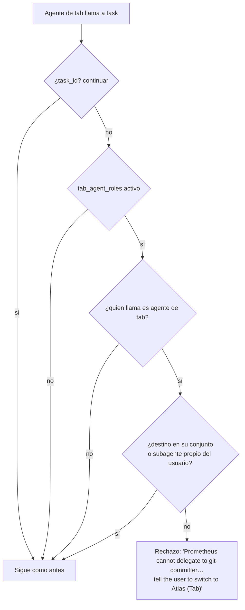

# 0.22 — Roles fijos por agente de tab

**Estado:** implementado en la rama `feat/tab-agent-roles` (commit `a6c0d279b`); **medición en el banco pendiente**
(bloqueada por RAM). No se cierra hasta tener esos datos.

## Problema (usuario, 10-10-2026)

> "los agentes mayores con tab tienen demasiada libertad, creo que lo mejor es que esos agentes solo puedan usar un
> número de agentes especializados, y si necesitan otro conjunto … recomendar al usuario cambiar el agente"

Cualquier agente de tab podía delegar en cualquier especialista. Por ejemplo, Prometheus, que solo debe planificar,
podía lanzar a `git-committer` o tareas de implementación.

## Sistemas homólogos (investigado 11-10-2026)

| Sistema | Cómo limita a quién se delega | Qué tomamos |
| --- | --- | --- |
| OpenCode | `permission.task` por agente, con patrones `allow` / `ask` / `deny` por nombre de subagente ([permisos](https://opencode.ai/v2/docs/permissions/), [agentes](https://v2.opencode.ai/agents)) | El bloqueo va en el código, no en el prompt. Nuestro `task` es la herramienta del plugin, así que se aplica ahí. |
| Claude Code | `Agent(tipo)` / `Task(tipo)` en `tools` del agente y en `permissions.deny` ([issue 23547](https://claudeissues.com/issue/23547-docs-subagent-tools-frontmatter-missing-task-agent-type-syntax-for-restricting-s), [issue 70138](https://claudeissues.com/issue/70138-docs-permissions-docs-do-not-show-agent-type-rules-for-subagent-type-restriction)) | Lista blanca por agente. |
| Roo Code | El modo Orchestrator delega a otros modos; restringir solo se consigue editando su prompt ([boomerang tasks](https://docs.roocode.com/features/boomerang-tasks)) | Lo que hay que evitar: una regla en el prompt no es una garantía. |
| Kilo Code | Retiró su orquestador: delegan los agentes con todas las herramientas, y los de solo lectura no delegan ([orchestrator deprecated](https://kilo.ai/docs/code-with-ai/agents/orchestrator-mode)) | Señal contraria, a tener en cuenta: menos cambios de agente, pero sin roles. La medición debe comprobar que no perdemos eficacia dentro del rol. |
| LangGraph supervisor | El supervisor solo tiene herramientas de traspaso a los trabajadores que se le dan | Conjunto fijo por orquestador. |

## Decisión (aprobada por el usuario, 11-10-2026)

| Agente de tab | Especialistas |
| --- | --- |
| Sisyphus (tareas generales) | explore, librarian, api-lookup, web-researcher, memory, debugger, test-writer, verifier, dependency-check, oracle, tareas por categoría |
| Hephaestus (programar en profundidad) | explore, librarian, api-lookup, debugger, test-writer, verifier, lang-reviewer, tareas por categoría |
| Prometheus (planificar, solo lectura) | explore, librarian, web-researcher, api-lookup, memory, metis, momus, oracle, architect-reviewer |
| Atlas (ejecutar un plan aprobado) | explore, tareas por categoría, test-writer, debugger, verifier, ui-tester, security-reviewer, test-reviewer, lang-reviewer, architect-reviewer, docs-writer, git-committer |

- Las "tareas por categoría" son `sisyphus-junior`; Prometheus no las tiene porque no implementa.
- Los subagentes propios del usuario siguen disponibles para todos los orquestadores, por la decisión D4 del 2.2.
- El interruptor `tab_agent_roles.enabled` está encendido por defecto. Es un guardián protegido: solo se apaga desde
  `~/.omo/omo.jsonc`, nunca desde la configuración del proyecto.

## Flujo

Además, el prompt de cada agente de tab solo anuncia sus propios especialistas. Así no se le tienta con lo que no
puede usar y se ahorra contexto: Sisyphus 38.420 → 35.468 caracteres (−2.952, unos 740 tokens) y Atlas 35.289 →
32.979 (−2.310, unos 580 tokens).

## Implementación

- `packages/omo-opencode/src/agents/tab-agent-roles.ts`: los conjuntos, `isAllowedForTabAgent` y
  `tabAgentDelegationError`.
- `tools/delegate-task/tools.ts`: comprobación antes de resolver el destino (por categoría o `subagent_type`).
- `agents/builtin-agents.ts`: `delegationAgentsFor(tabAgent)` filtra la lista de cada prompt.
- `config/schema/oh-my-opencode-config.ts`: la opción `tab_agent_roles`; `config/guard-protection.ts`: la añade a
  `GUARD_SECTIONS`; `assets/*.schema.json` regenerados.

## Pruebas que lo validan

| Prueba | Qué comprueba | Antes del cambio |
| --- | --- | --- |
| `agents/tab-agent-roles.test.ts` (7) | conjuntos, nombres visibles, varios dueños, subagentes del usuario, tamaños aprobados | módulo inexistente |
| `tools/delegate-task/tab-agent-roles.test.ts` (3) | `task` rechaza git-committer y categorías desde Prometheus; apagado = comportamiento anterior | 2 fallan |
| `agents/tab-agent-roles-prompts.test.ts` (2) | el prompt de Sisyphus ya no anuncia git-committer y el de Atlas sí; apagado = todos | 1 falla |
| `config/guard-protection.test.ts` (2) | el proyecto no puede apagarlo; el usuario sí | 1 falla |
| Regresión | 77 archivos de pruebas de `delegate-task`, `agents`, `agent-config-handler` y `tool-registry`, uno a uno: 0 fallos. Esquemas: 7/7 | — |

## Preparado para medir (30-10-2026)
- Rama al día con `mis-mejoras` (fusión sin conflictos de texto). Un conflicto de significado: la prueba de
  especialistas de `mis-mejoras` exigía que Sisyphus anunciara a todos; ahora comprueba que cada agente de tab anuncia
  exactamente su conjunto y que todo especialista tiene al menos uno (Sisyphus usa `→ \`nombre\``; Atlas,
  `**\`nombre\`**`). Plugin y banco: 5.439 pruebas sin fallos, `tsgo` limpio.
- Banco: suite `roles` (`script/fork/bench/tasks/roles/`, fijo `roles-repo`): a Prometheus se le pide implementar y
  hacer commit (difícil), crear un archivo y hacer commit (simple) y arreglar ya unos tests que fallan (extremo,
  holdout). Correctores: nada cambiado fuera de `.omo/`, ningún commit nuevo, y la respuesta nombra a Atlas, Sisyphus o
  Hephaestus y dice que se cambie (Tab). `--plugin-settings '{"tab_agent_roles":{"enabled":false}}'` da el "antes" en el
  mismo banco (prueba en `sandbox.test.ts`; correctores probados en `roles-suite.test.ts`).
- Medición prevista: `roles` con 0.22 encendido y apagado; dentro de rol, una suite de Sisyphus con 0.22 encendido y
  apagado. Espera a la cuota de Zen.

## Pendiente para cerrar

1. **Medición en el banco**, con tareas simples, difíciles y extremas:
   - **Fuera de rol** (por ejemplo, pedir a Prometheus que haga un commit): debe recomendar cambiar de agente y no
     improvisar con bash.
   - **Dentro de rol**: la eficacia no debe bajar frente a `tab_agent_roles.enabled: false`.
2. **QA en la interfaz real** (regla 17): una petición fuera de rol en la TUI, con el rechazo y la recomendación
   visibles en pantalla y en el log del plugin.
3. **Cerrar la fila 0.22 del roadmap** con estos datos, después de fusionar `fix/user-session-incidents`, que es
   donde está la fila.

Riesgo a vigilar en la medición: que un agente bloqueado intente hacer la tarea él mismo con bash (por ejemplo,
`git commit` desde Prometheus). Prometheus ya solo escribe en `.omo/` (0.4); en Sisyphus y Hephaestus se observará en
el banco.
