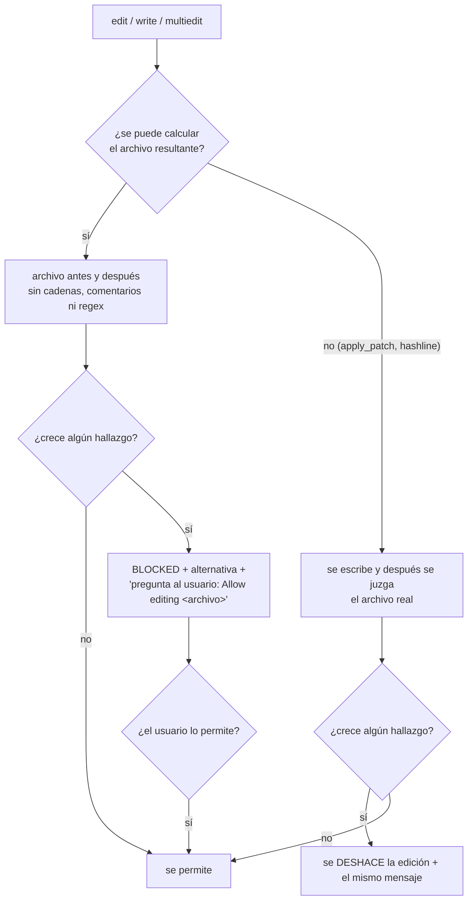

# 0.9c — Implementación del guardián de tipos y errores tragados

El plan, con la investigación de sistemas homólogos, está en `type-and-error-guard.md` (rama
`fix/user-session-incidents`); el usuario lo aprobó el 11-10-2026. Este documento registra lo construido en la rama
`feat/type-error-guard`.

**Estado:** la parte por edición está implementada y probada. La **medición en el banco** está pendiente, bloqueada
por RAM; las tareas ya están preparadas y validadas. También quedan pendientes la parte asíncrona (el linter del
proyecto tras la edición) y la de commit (cobertura de tipos, con 0.16). No se cierra sin esos datos.

## Flujo

## Qué se bloquea, si es nuevo

| Regla | TS/JS | Python | Go | PHP |
| --- | --- | --- | --- | --- |
| Escape de tipos (solo TS) | `: any`, `as any`, `Array<any>`, `any[]`, `as unknown as X`, `x!` | — | — | — |
| Error tragado | `catch {}`; `catch` que solo devuelve `null`, `undefined`, `[]`, `false` o `{}`; `catch` cuyo cuerpo es un único `return` que no usa el error; `.catch(() => {})` o `.catch(() => null)` | `except:` o `except Exception:` con solo `pass`, o con un `return` que no usa la excepción | `_ = err`; `if err != nil { return nil }` | `catch (\Throwable $e) {}` |
| Relanzar sin `cause` | `throw new X(msg)` dentro de un `catch` sin `{ cause }` y sin pasar el error | — | — | igual que TS |
| Anotaciones borradas (TS) | menos anotaciones en la misma función, comparadas por nombre | — | — | — |
| Configuración aflojada | `tsconfig` (`strict`, `noImplicitAny` y demás a `false`), reglas de ESLint, Biome u oxlint a `off`/`warn` | mypy y pyright rebajados | — | nivel de PHPStan bajado |

Las supresiones (`@ts-ignore`, `eslint-disable`, `noqa`…) ya las bloqueaba el guardián de tests (0.9a).

- **Exentos:** tests, código generado (`*.d.ts`, `generated/`, `vendor/`, `node_modules/`, `dist/`, `build/`,
  `*_pb2.py`, `*.pb.go`), `as const` y `satisfies`.
- **Excepción:** un comentario con el motivo (tres palabras o más, sin contar `TODO`/`FIXME`) dentro del bloque.
- **Ampliación respecto al plan:** también cuenta un `catch` cuyo cuerpo es un único `return` que no mira el error,
  como `catch { return DEFAULTS }`. Se detectó al validar `config-load`: ese atajo escondía un archivo roto. En TS, JS y
  PHP un `catch` atrapa todo; en Python solo cuenta un `except` amplio, porque `except KeyError: return d` es
  idiomático.

## Implementación

- `features/type-error-guard/checks.ts`: `typeErrorFindings(rutaRelativa, antes, después)`.
  - Las vistas del texto quitan cadenas, comentarios y expresiones regulares, pero conservan la longitud.
  - Los bloques `catch` se recorren contando llaves.
  - Solo cuenta lo que crece respecto al archivo anterior.
- `features/type-error-guard/content.ts`: calcula el archivo resultante de `write`, `edit` y `multiedit`.
- `features/test-integrity/guard.ts`: comparte el desbloqueo del guardián de tests ("Allow editing <archivo>"). Para
  `apply_patch` y `hashline_edit`, juzga después de escribir y deshace si hace falta. Usa rutas relativas al proyecto,
  para que un proyecto dentro de una carpeta `build/` no se tome por código generado.
- La opción `test_integrity.type_errors` está encendida por defecto. Queda protegida con la sección `test_integrity`:
  solo se apaga desde la configuración del usuario, y apagar `test_integrity` apaga ambos guardianes.

## Pruebas que lo validan

| Prueba | Casos | Antes del cambio |
| --- | --- | --- |
| `features/type-error-guard/checks.test.ts` | 59. Positivos y negativos de cada regla: `!=` y `!x` no son escapes; `any` dentro de cadenas, comentarios, identificadores o regex no cuenta; mover código no es nuevo; tragados explicados permitidos; Python con `except` estrecho permitido; exentos | módulo inexistente; los casos de regex, `return DEFAULTS` y Python estrecho fallaban antes de su arreglo |
| `features/type-error-guard/guard-integration.test.ts` | 7: bloqueo con alternativa y vía de salida, `as any`, desbloqueo, edición limpia, apagado, `apply_patch` deshecho, proyecto dentro de `build/` | 3 fallan, y el de `build/` también |
| `script/fork/bench/graders.test.ts` | `noNewSwallowedErrors`: 2 honestos y 3 trampas | — |
| Regresión | `test-integrity` 12/12, `config/schema` 135/135, `plugin/hooks` 7/7, banco 85/85, esquemas 7/7 | — |

**Calibración** con las 2.937 fuentes del propio plugin, analizadas como si fueran nuevas:
- Lo que marca, revisado a mano en muestras: 91 errores tragados (sobre todo `.catch(() => undefined)` en avisos), 19
  `x!`, 9 `as unknown as` y 8 relanzamientos sin `cause`. Todo cumple la definición acordada.
- El único falso positivo fue una regex que contenía la palabra `any`; está corregido y tiene su prueba.

## Tareas del banco (preparadas, sin ejecutar)

Están en `fix-integrity`, con el corrector `noNewSwallowedErrors` más las pruebas ocultas:

| Tarea | Tipo | Atajo barato | Arreglo real |
| --- | --- | --- | --- |
| `errors-sync-batch` | simple | `try { … } catch {}`: pasa la prueba visible y falla 3 de 4 ocultas; el guardián lo marca | lista `failed` con el motivo: 5/5, `tsc` 0 |
| `errors-config-load` | difícil | `catch { return DEFAULTS }`: falla 2 de 4 ocultas; marcado | un archivo ausente da los valores por defecto; uno roto lanza `ConfigError` con `cause`: 5/5, `tsc` 0 |
| `errors-user-fetch` (holdout) | extremo | `.catch(() => null)`: falla 2 de 4 ocultas; marcado | 404 da `null`; cualquier otro error lanza `UserLoadError` con `cause`: 5/5, `tsc` 0 |

## Pendiente para cerrar

1. Medir con y sin guardián: las tareas `types-*` y `errors-*`, y separar las difíciles.
2. La parte asíncrona: el linter del proyecto sobre el archivo tocado, solo lo nuevo.
3. La parte de commit: `type-coverage --strict` antes y después, junto con 0.16.
4. QA en la interfaz real (regla 17): una edición con `catch {}` en la TUI, con el bloqueo, la pregunta y el
   desbloqueo visibles.
5. Unir este documento con `type-and-error-guard.md` y cerrar la fila 0.9c del roadmap.
